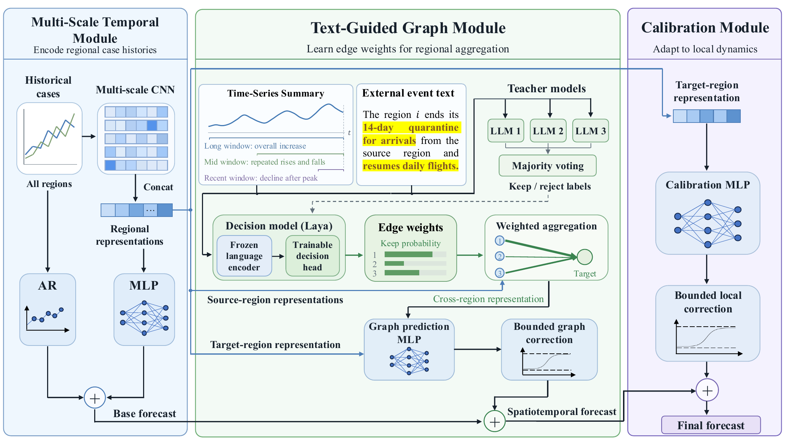

# TEGNet

TEGNet (Text-Guided Epidemic Graph Network) is a text-guided method for spatiotemporal epidemic forecasting. It combines historical case series with external event text to learn continuous weights for cross-region information aggregation and calibrates forecasts using the target region's temporal features.

The method consists of three core modules:

- **Multi-Scale Temporal Module (MTM):** Uses temporal patterns at multiple scales and an autoregressive component to produce base forecasts.
- **Text-Guided Graph Module (TGM):** Generates edge weights from historical time-series summaries and event text, aggregates source-region information, and adjusts the base forecast.
- **Calibration Module (CM):** Learns a correction for residual forecast bias from the target region's temporal representation to produce the final forecast.

The implementation covers three-teacher relation supervision, decision model pretraining, forecaster initialization, joint optimization, calibration training, monthly updates, and forecasting. Historical summaries include source-to-target importation pressure alongside the regional time-series comparison.

See [Method and Training](docs/method_and_training.md) for the equations, input conventions, and training stages. Dependencies are listed in [pyproject.toml](pyproject.toml). [configs/default.json](configs/default.json) records reference method settings; callers must read it and pass its values to the corresponding interfaces. The package does not load this file automatically.

## Implementation

- `models.py`: MTM, continuous-weight TGM, and target-region CM.
- `prompts.py` and `resources/prompt_templates.json`: historical summaries, shared context, and relation prompts.
- `experts.py`: three-teacher annotation and majority voting.
- `decision.py`: Laya inference, retention probabilities, and trainable decision parameters.
- `training.py`: staged optimization, monthly updates, and final forecasts.
- `candidates.py` and `data.py`: source selection, case scaling, and evaluation metrics.

Summary generation and teacher annotation accept model providers through their respective interfaces. The decision model uses Laya's pretrained encoder and decision network.

## License

Copyright (c) 2026 TEGNet authors. TEGNet is licensed under [Apache-2.0](LICENSE). Third-party attribution and license information are provided in [THIRD_PARTY_NOTICES.md](THIRD_PARTY_NOTICES.md).
